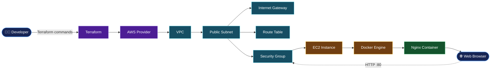

# Terraform AWS Docker Nginx

Infrastructure as Code project that provisions AWS networking and an EC2 instance using Terraform, installs Docker, and deploys an Nginx container to serve a web page.

## ⚡ Architecture



*The diagram is rendered by GitHub using Mermaid. The flow direction illustrates the deployment sequence; it is not a live animation.*

## 🛠️ Tech Stack

- **Cloud:** AWS EC2, VPC, Subnets, Internet Gateway, Route Tables, Security Groups
- **Infrastructure as Code:** Terraform
- **Containerization:** Docker
- **Web Server:** Nginx
- **Operating System:** Ubuntu
- **Version Control:** Git and GitHub

## 📁 Project Structure

```text
terraform-aws-docker-nginx/
├── main.tf
├── variables.tf
├── outputs.tf
├── providers.tf
└── README.md
```

*Terraform filenames may differ depending on the current repository structure.*

## ⚙️ Prerequisites

Install and configure:

- [Terraform](https://developer.hashicorp.com/terraform/install)
- [AWS CLI](https://docs.aws.amazon.com/cli/latest/userguide/getting-started-install.html)
- [Git](https://git-scm.com/downloads)
- An AWS account with permissions to create the required infrastructure

Configure AWS credentials using a supported AWS CLI profile or another secure credential method.

```bash
aws configure
aws sts get-caller-identity
```

Do not commit AWS credentials or Terraform state files to GitHub.

## 🚀 Setup and Deployment

### 1. Clone the repository

```bash
git clone https://github.com/devops-portfolio-vijay/terraform-aws-docker-nginx.git
cd terraform-aws-docker-nginx
```

### 2. Initialize Terraform

```bash
terraform init
```

Downloads the required providers and initializes the working directory.

### 3. Validate the configuration

```bash
terraform fmt -recursive
terraform validate
```

### 4. Review the infrastructure plan

```bash
terraform plan
```

Review the proposed AWS resources before creating them.

### 5. Deploy the infrastructure

```bash
terraform apply
```

Review the plan and enter `yes` when prompted to approve the changes.

Terraform provisions the resources defined in the configuration. The EC2 user-data script installs Docker and starts the Nginx container if those steps are included in the current configuration.

### 6. Access Nginx

Get the public IP from the Terraform output, if configured:

```bash
terraform output
```

Open the resulting public IP in your browser:

```text
http://<EC2_PUBLIC_IP>
```

Ensure the EC2 security group allows inbound HTTP traffic on port `80` from your intended client network.

## 🔍 Verify the Deployment

Connect to the EC2 instance using your configured access method and check Docker:

```bash
docker ps
docker images
```

Test Nginx locally on the instance:

```bash
curl -I http://localhost
```

A successful response typically includes an HTTP `200 OK` status.

## 🧹 Cleanup

To remove the resources managed by this Terraform configuration:

```bash
terraform destroy
```

Review the destruction plan and confirm when prompted. Check for any separately created resources that Terraform does not manage.

## 🔐 Security Notes

- Restrict SSH access to trusted IP addresses.
- Expose only the ports required by the application.
- Never commit private keys, credentials, or sensitive `.tfvars` files.
- Protect Terraform state because it can contain sensitive infrastructure information.
- Review AWS costs before deploying and destroy resources when they are no longer needed.

---

**Repository:** [terraform-aws-docker-nginx](https://github.com/devops-portfolio-vijay/terraform-aws-docker-nginx)
